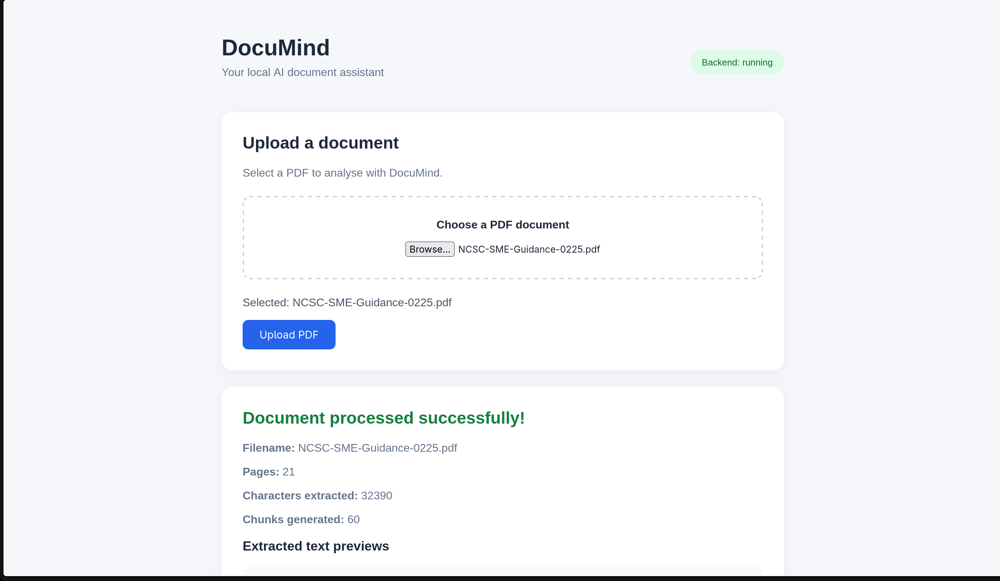

# DocuMind

An AI-powered document assistant that allows users to upload PDF
documents and ask questions about their contents using locally
hosted artificial intelligence.

DocuMind combines semantic search with a local large language model
to generate answers grounded in uploaded documents, including
references to the original PDF pages.

## Features

- Upload and process PDF documents
- Extract text and preserve original page numbers
- Split document text into overlapping chunks
- Generate semantic embeddings using Sentence Transformers
- Store and search document vectors using FAISS
- Generate AI-powered answers using Ollama
- View supporting passages and page references
- Responsive React frontend
- Automated backend testing
- Local AI processing without a paid API

## Technology Stack

### Frontend
- React
- JavaScript
- CSS
- Vite

### Backend
- Python
- FastAPI
- PyMuPDF
- Sentence Transformers
- FAISS
- Ollama
- Qwen 2.5 (1.5B)

### Testing
- Python unittest
- unittest.mock
- FastAPI TestClient
- Oxlint

## How It Works

DocuMind uses Retrieval-Augmented Generation (RAG).

1. The user uploads a PDF through the React interface.
2. FastAPI extracts the text using PyMuPDF.
3. The text is divided into overlapping chunks.
4. Sentence Transformers converts chunks into vector embeddings.
5. FAISS stores the embeddings for similarity searching.
6. The user submits a question.
7. FAISS retrieves the most relevant document passages.
8. Ollama generates an answer using the retrieved passages.
9. The frontend displays the answer and its supporting sources.

## Getting Started

### Prerequisites

- Python with support for the project dependencies
- Node.js and npm
- Ollama installed locally
- Git

### 1. Clone the repository

```bash
git clone https://github.com/Jaquo/Documind.git
cd Documind
```

### 2. Set up the backend

```bash
cd backend
python3 -m venv .venv
source .venv/bin/activate
python -m pip install -r requirements.txt
```

### 3. Download the AI model

Install and start Ollama, then run:

```bash
ollama pull qwen2.5:1.5b
```

Ollama must be running for AI question answering to work.

### 4. Start FastAPI

From the backend directory, with the virtual environment active:

```bash
python -m uvicorn main:app --reload
```

The API runs at:

http://127.0.0.1:8000

API documentation is available at:

http://127.0.0.1:8000/docs

### 5. Start the frontend

Open a second terminal:

```bash
cd ../frontend
npm install
npm run dev
```

Open the React application at:

http://localhost:5173

## API Endpoints

| Endpoint | Method | Description |
|----------|--------|-------------|
| `/` | GET | Check backend status |
| `/upload` | POST | Upload and process a PDF |
| `/search` | POST | Retrieve relevant document passages |
| `/ask` | POST | Generate an AI answer with sources |

## Running Tests

### Backend tests

From the backend directory:

```bash
python -m unittest discover -s tests -v
```

### Frontend linting

```bash
cd frontend
npm run lint
```

### Frontend production build

```bash
npm run build
```

## Current Limitations

- The application currently indexes one PDF at a time.
- Questions are answered independently rather than using
  conversational memory.
- AI-generated answers may occasionally be inaccurate.
- Source citations are generated by the model and should be verified.
- The application is designed primarily for local development.

## Future Improvements

- Support for multiple uploaded documents
- Persistent document library
- Conversational memory
- Improved citation verification
- Streaming AI responses
- Additional document formats

## Project Purpose

DocuMind was developed as a software engineering project to
explore full-stack development, artificial intelligence,
semantic search, API integration, and automated testing.

The project demonstrates how a modern React frontend can
communicate with a Python backend to provide AI-powered
document analysis using locally hosted models.
![DocuMind upload interface on a light gray background with the title DocuMind, the subtitle Your local AI document assistant, a green status pill reading Backend: running, and a main upload panel titled Upload a document. The panel shows a dashed upload area with the text Choose a PDF document and a selected file label reading NCSC-SME-Guidance-0225.pdf. Below it is a blue Upload PDF button. A second green success panel reads Document processed successfully, with the filename, page count, character count, and chunk count, and a preview section labeled Extracted text previews. The overall tone is clean, professional, and reassuring.]